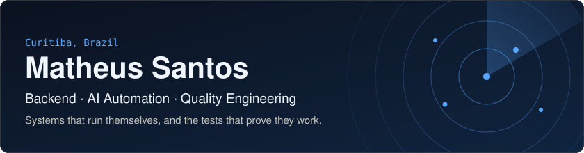
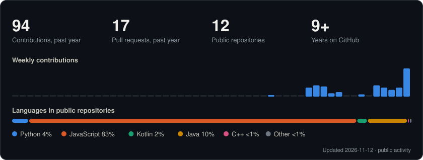

<picture>
  <source media="(prefers-color-scheme: dark)" srcset="assets/hero-dark.svg">
  <source media="(prefers-color-scheme: light)" srcset="assets/hero-light.svg">
  
</picture>

Senior QA Engineer and SDET with 10+ years across fintech, banking and healthcare. I test the backends, APIs and microservices behind financial products, and I build my own: real-time services, AI-driven automation, and computer vision on the edge.

## Tech stack

<table>
  <tr>
    <td width="190"><strong>Quality &amp; automation</strong></td>
    <td>     </td>
  </tr>
  <tr>
    <td width="190"><strong>Languages</strong></td>
    <td></td>
  </tr>
  <tr>
    <td width="190"><strong>Backend</strong></td>
    <td></td>
  </tr>
  <tr>
    <td width="190"><strong>AI &amp; vision</strong></td>
    <td> </td>
  </tr>
  <tr>
    <td width="190"><strong>Web &amp; mobile</strong></td>
    <td></td>
  </tr>
  <tr>
    <td width="190"><strong>IoT &amp; embedded</strong></td>
    <td></td>
  </tr>
  <tr>
    <td width="190"><strong>DevOps</strong></td>
    <td> </td>
  </tr>
</table>

## Experience

| Role | Company | Period | Focus |
|---|---|---|---|
| **Senior QA Engineer** | Evertec | 2025 – 2026 | API and end-to-end testing for banking and credit products |
| **QA Engineer** | WEX | 2023 – 2025 | Backend, REST API and microservice automation for payments and fleet |
| **QA Analyst** | Madero | 2020 – 2023 | Test automation architecture with Robot Framework and Python |
| **Test & Development Analyst** | Medibook | 2018 – 2020 | Quality and development for a healthcare platform |

Earlier: Technical Support Analyst at SEB, C# Developer at Telemetrix, Software Analyst Trainee at HSBC.

**Education:** B.Sc. Computer Science (UTP) · Postgraduate in Embedded Systems & IoT (Universidade Positivo) · MBA in Business Management (Cruzeiro do Sul)

**Languages:** Portuguese (native) · English (fluent) · Spanish (basic)

## Selected work

<table>
  <tr>
    <td width="50%" valign="top">
      <h3><a href="https://github.com/matmss/DevRadar">DevRadar</a></h3>
      Find developers nearby by tech stack, on a live map. One Express API serves a React web app and an Expo mobile app, with MongoDB geospatial search and Socket.io push.
        
      <strong>Quality:</strong> BDD suites for every layer, plus GitHub Actions for PR checks, regression and release.
    </td>
    <td width="50%" valign="top">
      <h3>AI office automation (private)</h3>
      AI-driven routines that automate day-to-day office processes, built with Claude Code and connected to the tools the office already uses.
        
      <strong>Design:</strong> scheduled runs and execution logs, with a human approving outgoing work.
    </td>
  </tr>
  <tr>
    <td width="50%" valign="top">
      <h3><a href="https://github.com/matmss/motion-detection-toolkit">motion-detection-toolkit</a></h3>
      A modular Python and OpenCV pipeline for motion detection, blob detection and tracking, behind one CLI.
        
      <strong>Edge:</strong> Raspberry Pi deployment, plus alwaysAI apps for object detection and image classification.
    </td>
    <td width="50%" valign="top">
      <h3><a href="https://github.com/matmss/tcc_iot_monitoramento_pisada">Gait monitoring IoT</a></h3>
      My postgraduate capstone in Embedded Systems and IoT: monitoring a person's gait from sensors built into a shoe.
        
      <strong>Stack:</strong> an Android app in Kotlin, with live visuals drawn in Processing.
    </td>
  </tr>
</table>

More: [task-manager](https://github.com/matmss/task-manager) (Node.js, MongoDB) · [java-selenium](https://github.com/matmss/java-selenium) · [desafioGestran](https://github.com/matmss/desafioGestran) (Robot Framework)

## GitHub stats

<picture>
  <source media="(prefers-color-scheme: dark)" srcset="assets/stats-dark.svg">
  <source media="(prefers-color-scheme: light)" srcset="assets/stats-light.svg">
  
</picture>
